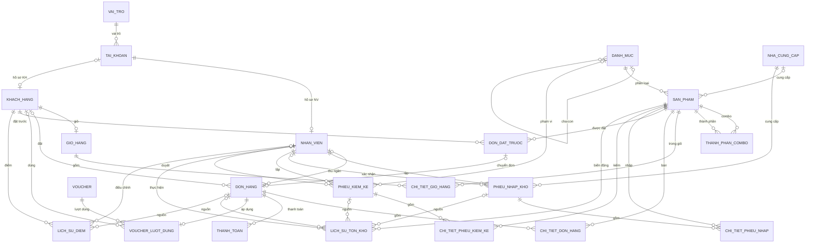

# Thiết kế cơ sở dữ liệu — Hệ thống nhà sách BookMark

> Trạng thái: đã chốt sau 4 vòng duyệt.  
> Tài liệu này là nguồn tham chiếu cho `schema.prisma` và migration SQL.  
> Phạm vi: 17 use case trong `docs/spec.md`. Không bao gồm theo dõi vận chuyển.

## 0. Quy ước chung

- Tổng cộng **22 bảng**, chia 5 nhóm.
- Bảng nghiệp vụ dùng **UUID**; ba bảng danh mục nhỏ dùng **INT**: `VaiTro`, `DanhMuc`, `NhaCungCap`.
- `TaiKhoan` chỉ giữ thông tin đăng nhập; `NhanVien` và `KhachHang` là hồ sơ nghiệp vụ tương ứng.
- Khách mua tại quầy có thể có `KhachHang` mà không cần `TaiKhoan`.
- Không xóa cứng dữ liệu đã phát sinh giao dịch; dùng trạng thái.
- Tiền: `NUMERIC(12,2)` cho đơn giá, `NUMERIC(14,2)` cho tổng tiền.
- `SanPham.so_luong_ton` là số tồn hiện tại; `LichSuTonKho` là nhật ký biến động. Mọi thay đổi tồn phải nằm trong một transaction.
- `VaiTro` là bảng dữ liệu + seed, **không dùng enum PostgreSQL**.
- Không có cột trạng thái vận chuyển trong phạm vi hiện tại (xem 4.7).

---

# Phần 1/4 — Tài khoản và phân quyền

## 1.1. Nhóm A — Bảng

| Bảng | PK | FK | UK | Trường chính |
|---|---|---|---|---|
| `VaiTro` | `vai_tro_id` INT | — | `ma_vai_tro` | `ten_vai_tro`, `mo_ta`, `ngay_tao` |
| `TaiKhoan` | `id` UUID | `vai_tro_id` → `VaiTro` | `username` | `password_hash`, `trang_thai`, `lan_dang_nhap_cuoi`, `ngay_tao`, `ngay_cap_nhat` |
| `NhanVien` | `id` UUID | `tai_khoan_id` → `TaiKhoan` | `tai_khoan_id`, `ma_nv`, `email`*, `sdt`* | `ho_ten`, `ngay_vao_lam`, `trang_thai`, `ngay_tao` |
| `KhachHang` | `id` UUID | `tai_khoan_id` → `TaiKhoan` (nullable) | `tai_khoan_id`*, `sdt`*, `email`* | `ho_ten`, `diem_tich_luy`, `dia_chi_mac_dinh`, `trang_thai`, `ngay_tao` |

`UK*` = unique khi giá trị khác `NULL`.

## 1.2. Chốt tài khoản và đăng nhập

- `TaiKhoan.username` là định danh đăng nhập **độc lập**, không bắt buộc là email/số điện thoại.
- Khách hàng đăng nhập bằng một trong ba định danh:
  1. `TaiKhoan.username`
  2. `KhachHang.email`
  3. `KhachHang.sdt`
- Service chuẩn hóa định danh và kiểm tra trùng trên cả ba nguồn trước khi tạo tài khoản.
- `KhachHang.sdt` **nullable**, unique khi khác `NULL`.
- `KhachHang.email` **nullable**, unique khi khác `NULL`.
- Ràng buộc: mỗi `KhachHang` phải có ít nhất `sdt` hoặc `email`.
- Khách tạo tại POS bắt buộc nhập `sdt` ở tầng service.
- Đăng ký khách hàng = tạo `TaiKhoan` + `KhachHang` trong cùng transaction.
- Tạo tài khoản nhân viên = tạo `TaiKhoan` + `NhanVien` trong cùng transaction.

## 1.3. Ràng buộc vai trò — hồ sơ

Thực hiện ở **service**, trong cùng transaction:

- Vai trò `KHACH_HANG` → có đúng một `KhachHang`, không có `NhanVien`.
- Vai trò `ADMIN` / `THU_NGAN` / `NHAN_VIEN_KHO` → có đúng một `NhanVien`, không có `KhachHang`.
- Đổi vai trò phải kiểm tra hồ sơ hiện có; không tự tạo/xóa chéo.
- Tài khoản bị khóa dùng `TaiKhoan.trang_thai = BI_KHOA`; không xóa cứng.

## 1.4. Quan hệ nhóm A

```text
VAI_TRO     1 ─── n     TAI_KHOAN
TAI_KHOAN   1 ─── 0..1  NHAN_VIEN
TAI_KHOAN   1 ─── 0..1  KHACH_HANG
```

---

# Phần 2/4 — Danh mục, sản phẩm, bán hàng

## 2.1. Nhóm B — Danh mục và sản phẩm

| Bảng | PK | FK | UK | Trường chính |
|---|---|---|---|---|
| `DanhMuc` | `danh_muc_id` INT | `danh_muc_cha_id` → `DanhMuc` | `slug` | `ten_danh_muc`, `mo_ta`, `thu_tu`, `trang_thai` |
| `NhaCungCap` | `nha_cung_cap_id` INT | — | `ma_ncc` | `ten_nha_cung_cap`, `sdt_lien_he`, `email`, `dia_chi`, `trang_thai` |
| `SanPham` | `id` UUID | `danh_muc_id` → `DanhMuc`; `nha_cung_cap_id` → `NhaCungCap` (nullable) | `ma_sp`; `isbn`* | `ten_sp`, `loai_sp`, `tac_gia`, `nha_xuat_ban`, `nam_xuat_ban`, `mo_ta`, `hinh_anh`, `gia_ban`, `so_luong_ton`, `nguong_ton_toi_thieu`, `trang_thai`, `ngay_tao`, `ngay_cap_nhat` |
| `ThanhPhanCombo` | (`combo_id`, `san_pham_id`) | `combo_id` → `SanPham`; `san_pham_id` → `SanPham` | — | `so_luong` |

### Chốt nghiệp vụ sản phẩm

- `SanPham.loai_sp`: `SACH`, `TRUYEN_TRANH`, `DO_DUNG_HOC_TAP`, `BO_TRUYEN`, `COMBO`.
- `SanPham.trang_thai`: `DANG_BAN`, `NGUNG_BAN`.
- Combo/bộ truyện là **hàng đóng gói sẵn, có tồn kho riêng**; `ThanhPhanCombo` chỉ để hiển thị thành phần. Bán combo trừ tồn của chính combo.
- `SanPham` đã phát sinh giao dịch chỉ chuyển `NGUNG_BAN`, không xóa.
- `ThanhPhanCombo`: `combo_id <> san_pham_id`, `so_luong > 0`.
- `SanPham.danh_muc_id` và `nha_cung_cap_id` dùng `RESTRICT`/`RESTRICT` khi xóa danh mục/nhà cung cấp.

### Quan hệ nhóm B

```text
DANH_MUC       0..1 ─── n  DANH_MUC        (cha – con)
DANH_MUC       1    ─── n  SAN_PHAM
NHA_CUNG_CAP   0..1 ─── n  SAN_PHAM
SAN_PHAM       1    ─── n  THANH_PHAN_COMBO   (vai trò: combo)
SAN_PHAM       1    ─── n  THANH_PHAN_COMBO   (vai trò: thành phần)
```

## 2.2. Nhóm C — Bán hàng online và POS

| Bảng | PK | FK | UK | Trường chính |
|---|---|---|---|---|
| `GioHang` | `id` UUID | `khach_hang_id` → `KhachHang` | `khach_hang_id` | `ngay_tao`, `ngay_cap_nhat` |
| `ChiTietGioHang` | (`gio_hang_id`, `san_pham_id`) | `gio_hang_id` → `GioHang`; `san_pham_id` → `SanPham` | — | `so_luong`, `ngay_them` |
| `Voucher` | `id` UUID | — | `ma_voucher` | `ten_voucher`, `loai_giam`, `gia_tri`, `gia_tri_don_toi_thieu`, `giam_toi_da`, `so_luong` (nullable), `da_su_dung`, `gioi_han_moi_khach` (nullable), `ap_dung_kenh`, `ngay_bat_dau`, `ngay_ket_thuc`, `trang_thai` |
| `DonHang` | `id` UUID | `khach_hang_id` → `KhachHang` (nullable); `nhan_vien_id` → `NhanVien` (nullable) | `ma_dh` | `kenh_ban`, `trang_thai`, `tien_hang`, `tien_giam_voucher`, `tien_giam_diem`, `phi_van_chuyen`, `tong_tien`, `diem_su_dung`, `diem_cong`, `ten_nguoi_nhan`, `sdt_nguoi_nhan`, `dia_chi_giao_hang`, `ghi_chu`, `ngay_tao`, `ngay_thanh_toan` |
| `ChiTietDonHang` | (`don_hang_id`, `san_pham_id`) | `don_hang_id` → `DonHang`; `san_pham_id` → `SanPham` | — | `so_luong`, `don_gia`, `thanh_tien` |
| `ThanhToan` | `id` UUID | `don_hang_id` → `DonHang` | `ma_giao_dich`* | `phuong_thuc`, `so_tien`, `trang_thai`, `thoi_gian`, `ma_phan_hoi` |
| `VoucherLuotDung` | `id` UUID | `voucher_id` → `Voucher`; `don_hang_id` → `DonHang`; `khach_hang_id` → `KhachHang` (nullable) | `don_hang_id` | `so_tien_giam`, `ngay_dung` |
| `DonDatTruoc` | `id` UUID | `khach_hang_id` → `KhachHang`; `san_pham_id` → `SanPham`; `don_hang_id` → `DonHang` (nullable) | `ma_ddt`; `don_hang_id`* | `so_luong`, `ten_nguoi_nhan`, `sdt_nguoi_nhan`, `dia_chi`, `trang_thai`, `ngay_tao`, `ngay_bao_co_hang`, `ghi_chu` |

### Chốt nghiệp vụ bán hàng

- `DonHang.kenh_ban`: `POS`, `ONLINE`.
- `DonHang.trang_thai`: `CHO_THANH_TOAN`, `DA_THANH_TOAN`, `CHO_HOAN_TIEN`, `DA_HOAN_TIEN`, `DA_HUY`.
- Đơn `ONLINE`: bắt buộc `khach_hang_id` + thông tin nhận hàng; `nhan_vien_id` để trống.
- Đơn `POS`: bắt buộc `nhan_vien_id`; `khach_hang_id` có thể trống nếu khách lẻ.
- Một đơn chỉ áp tối đa một voucher, thể hiện qua `VoucherLuotDung.don_hang_id` unique.
- `ThanhToan` có thể có nhiều lần thử; chỉ một bản ghi `THANH_CONG` cho mỗi đơn.
- `DonDatTruoc` chứa một sản phẩm; khi chuyển thành đơn thật thì ghi `don_hang_id` và đổi trạng thái `DA_CHUYEN_DON`.
- `GioHang` chỉ dành cho khách đã đăng nhập; mỗi khách có tối đa một giỏ đang hoạt động.
- `ChiTietGioHang` **không lưu `don_gia`**; giá hiển thị lấy từ `SanPham.gia_ban`, chỉ chốt khi tạo `ChiTietDonHang`.
- `ChiTietDonHang` và `ChiTietGioHang` dùng khóa ghép; service cộng dồn nếu cùng sản phẩm.

### Quan hệ nhóm C

```text
KHACH_HANG     1    ─── 0..1  GIO_HANG
GIO_HANG       1    ─── n     CHI_TIET_GIO_HANG
SAN_PHAM       1    ─── n     CHI_TIET_GIO_HANG

KHACH_HANG     0..1 ─── n     DON_HANG
NHAN_VIEN      0..1 ─── n     DON_HANG
DON_HANG       1    ─── n     CHI_TIET_DON_HANG
SAN_PHAM       1    ─── n     CHI_TIET_DON_HANG
DON_HANG       1    ─── n     THANH_TOAN

VOUCHER        1    ─── n     VOUCHER_LUOT_DUNG
DON_HANG       1    ─── 0..1  VOUCHER_LUOT_DUNG
KHACH_HANG     0..1 ─── n     VOUCHER_LUOT_DUNG

KHACH_HANG     1    ─── n     DON_DAT_TRUOC
SAN_PHAM       1    ─── n     DON_DAT_TRUOC
DON_DAT_TRUOC  0..1 ─── 0..1  DON_HANG      (khi chuyển đơn)
```

# Phần 3/4 — Quản lý kho và điểm tích lũy

## 3.1. Nhóm D — Quản lý kho

| Bảng | PK | FK | UK | Trường chính |
|---|---|---|---|---|
| `PhieuNhapKho` | `id` UUID | `nha_cung_cap_id` → `NhaCungCap`; `nguoi_lap_id` → `NhanVien`; `nguoi_xac_nhan_id` → `NhanVien` (nullable) | `ma_pn` | `trang_thai`, `tong_tien`, `ngay_nhap`, `ngay_tao`, `ngay_xac_nhan`, `ghi_chu` |
| `ChiTietPhieuNhap` | (`phieu_nhap_id`, `san_pham_id`) | `phieu_nhap_id` → `PhieuNhapKho`; `san_pham_id` → `SanPham` | — | `so_luong`, `gia_nhap`, `thanh_tien` |
| `PhieuKiemKe` | `id` UUID | `danh_muc_id` → `DanhMuc` (nullable); `nguoi_lap_id` → `NhanVien`; `nguoi_duyet_id` → `NhanVien` (nullable) | `ma_pkk` | `trang_thai`, `ngay_tao`, `ngay_gui`, `ngay_duyet`, `ly_do_tu_choi`, `ghi_chu` |
| `ChiTietPhieuKiemKe` | (`phieu_kiem_ke_id`, `san_pham_id`) | `phieu_kiem_ke_id` → `PhieuKiemKe`; `san_pham_id` → `SanPham` | — | `so_luong_he_thong`, `so_luong_thuc_te`, `chenh_lech`, `ghi_chu` |
| `LichSuTonKho` | `id` UUID | `san_pham_id` → `SanPham`; `nguoi_thuc_hien_id` → `NhanVien` (nullable); `phieu_nhap_id` / `don_hang_id` / `phieu_kiem_ke_id` → nguồn tương ứng (nullable) | — | `loai_bien_dong`, `so_luong_thay_doi`, `so_luong_truoc`, `so_luong_sau`, `ngay_tao`, `ghi_chu` |

### Chốt nghiệp vụ kho

- `PhieuNhapKho` có 4 trạng thái: nháp, chờ xác nhận, đã nhập kho, đã hủy. Chỉ khi chuyển sang **đã nhập kho** mới cộng tồn.
- Xác nhận phiếu nhập phải ghi `nguoi_xac_nhan_id` và `ngay_xac_nhan`.
- `PhieuKiemKe.danh_muc_id = NULL` nghĩa là kiểm kê toàn bộ cửa hàng.
- Mỗi nhóm hàng chỉ có tối đa **một phiếu kiểm kê đang mở** (nháp hoặc chờ duyệt). Toàn cửa hàng và theo danh mục không được chồng nhau.
- Duyệt kiểm kê: **cộng `chenh_lech` vào tồn hiện tại**, không gán đè:
  `so_luong_ton = so_luong_ton + chenh_lech`.
- Từ chối kiểm kê: không đổi tồn và bắt buộc nhập `ly_do_tu_choi`.
- `ChiTietPhieuKiemKe.chenh_lech = so_luong_thuc_te - so_luong_he_thong`.
- `LichSuTonKho` là **append-only**, không sửa/xóa. Mỗi bản ghi có tối đa một nguồn tham chiếu; điều chỉnh tay để trống cả ba.
- Công thức kiểm tra: `so_luong_sau = so_luong_truoc + so_luong_thay_doi` và `so_luong_sau >= 0`.
- `PhieuNhapKho.tong_tien` = tổng `ChiTietPhieuNhap.thanh_tien`; `thanh_tien = so_luong * gia_nhap`.
- Phiếu nhập đã `DA_NHAP_KHO` **không được hủy**; chỉ hủy khi còn `NHAP` hoặc `CHO_XAC_NHAN`.
- `ngay_nhap` là ngày nhận hàng theo chứng từ, do người lập chọn; `ngay_tao` là thời điểm tạo phiếu; `ngay_xac_nhan` là thời điểm hệ thống cộng tồn. Sổ kho ghi theo `ngay_xac_nhan`; báo cáo nhập hàng có thể dùng `ngay_nhap`.

## 3.2. Nhóm E — Điểm tích lũy

| Bảng | PK | FK | UK | Trường chính |
|---|---|---|---|---|
| `LichSuDiem` | `id` UUID | `khach_hang_id` → `KhachHang`; `don_hang_id` → `DonHang` (nullable); `nguoi_thuc_hien_id` → `NhanVien` (nullable) | — | `loai`, `so_diem`, `so_du_sau`, `ngay_tao`, `ghi_chu` |

### Chốt nghiệp vụ điểm

- `LichSuDiem` là append-only; mọi cộng/trừ/hoàn/thu hồi điểm đều phải ghi log.
- `so_du_sau >= 0`; `so_diem > 0` và dấu âm/dương thể hiện qua `loai`.
- `LichSuDiem.loai` gồm:
  - `CONG`: cộng điểm thưởng khi mua.
  - `TRU`: khách dùng điểm.
  - `HOAN_DIEM`: hoàn lại điểm đã dùng khi hủy/hoàn đơn.
  - `THU_HOI_DIEM`: thu hồi điểm đã cộng khi hủy/hoàn đơn.
  - `DIEU_CHINH`: Admin chỉnh tay.
- Điểm được cộng khi đơn POS/online thanh toán thành công; trừ khi khách dùng điểm.
- Điều chỉnh tay bởi Admin phải ghi `nguoi_thuc_hien_id` và `ghi_chu`.
- Khi thu hồi điểm mà số dư không đủ, không để âm; ghi phần thiếu vào `ghi_chu` để Admin đối soát.

## 3.3. Quan hệ nhóm D và E

```text
NHA_CUNG_CAP   1    ─── n     PHIEU_NHAP_KHO
NHAN_VIEN      1    ─── n     PHIEU_NHAP_KHO     (người lập)
NHAN_VIEN      0..1 ─── n     PHIEU_NHAP_KHO     (người xác nhận)
PHIEU_NHAP_KHO 1    ─── n     CHI_TIET_PHIEU_NHAP
SAN_PHAM       1    ─── n     CHI_TIET_PHIEU_NHAP

DANH_MUC       0..1 ─── n     PHIEU_KIEM_KE       (NULL = toàn bộ)
NHAN_VIEN      1    ─── n     PHIEU_KIEM_KE       (người lập)
NHAN_VIEN      0..1 ─── n     PHIEU_KIEM_KE       (người duyệt)
PHIEU_KIEM_KE  1    ─── n     CHI_TIET_PHIEU_KIEM_KE
SAN_PHAM       1    ─── n     CHI_TIET_PHIEU_KIEM_KE

SAN_PHAM       1    ─── n     LICH_SU_TON_KHO
NHAN_VIEN      0..1 ─── n     LICH_SU_TON_KHO
PHIEU_NHAP_KHO 0..1 ─── n     LICH_SU_TON_KHO
DON_HANG       0..1 ─── n     LICH_SU_TON_KHO
PHIEU_KIEM_KE  0..1 ─── n     LICH_SU_TON_KHO

KHACH_HANG     1    ─── n     LICH_SU_DIEM
DON_HANG       0..1 ─── n     LICH_SU_DIEM
NHAN_VIEN      0..1 ─── n     LICH_SU_DIEM
```

## 3.4. Luồng kho chốt

1. **Nhập kho:** lập phiếu → chờ xác nhận → xác nhận trong transaction: cộng tồn từng dòng, ghi `LichSuTonKho`, đổi trạng thái phiếu.
2. **Bán hàng:** trừ tồn + ghi log khi đơn được chốt/thanh toán thành công.
   - Dùng UPDATE có điều kiện `so_luong_ton >= n`.
   - Nếu affected rows = 0 → thiếu hàng, rollback toàn bộ giao dịch.
   - POS báo lỗi và yêu cầu chỉnh giỏ; online chuyển `CHO_HOAN_TIEN` nếu đã thanh toán.
3. **Kiểm kê:** nhập số thực tế → gửi duyệt → Admin duyệt mới cộng `chenh_lech` vào tồn và ghi log; từ chối thì không đổi tồn.
4. **Hủy/hoàn đơn:** xem 3.5.
5. **Đặt trước:** xem 3.6.

## 3.5. Luồng hủy đơn

### Đơn chưa thanh toán

```text
CHO_THANH_TOAN → DA_HUY
```

- Không hoàn tiền.
- Không thay đổi tồn kho.
- Không cộng/trừ điểm.
- Nếu đã áp voucher: giảm `Voucher.da_su_dung` (nếu đã tăng) và không tính lượt dùng khi kiểm tra hạn mức.

### Đơn đã thanh toán

```text
DA_THANH_TOAN → CHO_HOAN_TIEN → DA_HOAN_TIEN
```

Trong transaction hoàn tiền:

- Hoàn tồn kho nếu đơn đã trừ tồn; ghi `LichSuTonKho` với `loai_bien_dong = HOAN_TRA`.
- Hoàn điểm đã dùng: ghi `LichSuDiem.loai = HOAN_DIEM`.
- Thu hồi điểm đã cộng: ghi `LichSuDiem.loai = THU_HOI_DIEM`.
- Giảm `Voucher.da_su_dung` nếu voucher đã được tính; giữ bản ghi `VoucherLuotDung` làm lịch sử.
- Cập nhật `ThanhToan.trang_thai = DA_HOAN_TIEN` sau khi hoàn tiền thành công.
- Nếu hoàn tiền thất bại, đơn giữ `CHO_HOAN_TIEN` để Admin xử lý; không chuyển `DA_HOAN_TIEN`.

`DA_HUY` chỉ dùng cho đơn chưa thanh toán. Đơn đã thanh toán bị hủy kết thúc ở `DA_HOAN_TIEN`.

## 3.6. Đặt trước

Theo spec UC13, đặt trước **không thu tiền**:

- Không tạo `ThanhToan`, không trừ tồn, không cộng điểm.
- Chỉ lưu `DonDatTruoc` với trạng thái `CHO_HANG`.
- Khi hàng về → `DA_CO_HANG`, cửa hàng liên hệ khách.
- Khi khách mua → tạo `DonHang` thật, ghi `don_hang_id`, đổi trạng thái `DA_CHUYEN_DON`; tiền thanh toán nằm ở đơn hàng.
- Đặt cọc/thanh toán một phần không thuộc phạm vi spec.

# Phần 4/4 — Enum, ERD, ràng buộc và migration

## 4.1. Danh sách enum đầy đủ

`VaiTro` không dùng enum; dùng bảng + seed (xem 4.2).

| Enum | Giá trị |
|---|---|
| `SanPham.loai_sp` | `SACH`, `TRUYEN_TRANH`, `DO_DUNG_HOC_TAP`, `BO_TRUYEN`, `COMBO` |
| `SanPham.trang_thai` | `DANG_BAN`, `NGUNG_BAN` |
| `DanhMuc.trang_thai` | `HOAT_DONG`, `TAM_AN` |
| `NhaCungCap.trang_thai` | `HOAT_DONG`, `NGUNG_HOP_TAC` |
| `TaiKhoan.trang_thai` | `HOAT_DONG`, `BI_KHOA` |
| `NhanVien.trang_thai` | `DANG_LAM`, `DA_NGHI` |
| `KhachHang.trang_thai` | `HOAT_DONG`, `BI_KHOA` |
| `DonHang.kenh_ban` | `POS`, `ONLINE` |
| `DonHang.trang_thai` | `CHO_THANH_TOAN`, `DA_THANH_TOAN`, `CHO_HOAN_TIEN`, `DA_HOAN_TIEN`, `DA_HUY` |
| `ThanhToan.phuong_thuc` | `TIEN_MAT`, `VNPAY` |
| `ThanhToan.trang_thai` | `CHO_XU_LY`, `THANH_CONG`, `THAT_BAI`, `DA_HOAN_TIEN` |
| `Voucher.loai_giam` | `PHAN_TRAM`, `SO_TIEN` |
| `Voucher.ap_dung_kenh` | `TAT_CA`, `POS`, `ONLINE` |
| `Voucher.trang_thai` | `HOAT_DONG`, `TAM_DUNG`, `HET_HAN` |
| `DonDatTruoc.trang_thai` | `CHO_HANG`, `DA_CO_HANG`, `DA_HUY`, `DA_CHUYEN_DON` |
| `PhieuNhapKho.trang_thai` | `NHAP`, `CHO_XAC_NHAN`, `DA_NHAP_KHO`, `DA_HUY` |
| `PhieuKiemKe.trang_thai` | `NHAP`, `CHO_DUYET`, `DA_DUYET`, `TU_CHOI`, `DA_HUY` |
| `LichSuTonKho.loai_bien_dong` | `NHAP_KHO`, `BAN_HANG`, `KIEM_KE`, `HUY_DON`, `HOAN_TRA`, `DIEU_CHINH` |
| `LichSuDiem.loai` | `CONG`, `TRU`, `HOAN_DIEM`, `THU_HOI_DIEM`, `DIEU_CHINH` |

Tổng: **19 enum**, không tính `VaiTro`.

## 4.2. Seed bảng `VaiTro`

| `ma_vai_tro` | Tên hiển thị | Phạm vi |
|---|---|---|
| `ADMIN` | Quản trị viên | Toàn hệ thống |
| `THU_NGAN` | Nhân viên thu ngân | POS |
| `NHAN_VIEN_KHO` | Nhân viên kho | Nhập kho, tồn kho, kiểm kê |
| `KHACH_HANG` | Khách hàng | Mua hàng online |

Seed cố định 4 dòng; không thêm/xóa tùy tiện vì `TaiKhoan.vai_tro_id` tham chiếu.

## 4.3. ERD tổng



Ký hiệu: `||` = đúng 1, `o|` = 0 hoặc 1, `o{` = 0 hoặc nhiều.

## 4.4. Ràng buộc nghiệp vụ chính

### Sản phẩm và giỏ hàng

- `SanPham`: `gia_ban >= 0`, `so_luong_ton >= 0`, `nguong_ton_toi_thieu >= 0`.
- `ChiTietGioHang`, `ChiTietDonHang`, `ChiTietPhieuNhap`: `so_luong > 0`.
- `ChiTietPhieuKiemKe` **không có cột `so_luong`**; ràng buộc thực tế là `so_luong_he_thong >= 0`, `so_luong_thuc_te >= 0` và `chenh_lech = so_luong_thuc_te - so_luong_he_thong`.
- `ChiTietDonHang.don_gia >= 0`; `ChiTietPhieuNhap.gia_nhap >= 0`.
- `ChiTietGioHang` không lưu giá; giá hiển thị lấy từ `SanPham.gia_ban`, chỉ chốt khi tạo `ChiTietDonHang`.
- `ThanhPhanCombo`: `combo_id <> san_pham_id`, `so_luong > 0`.

### Đơn hàng và thanh toán

- `DonHang.tong_tien = tien_hang - tien_giam_voucher - tien_giam_diem + phi_van_chuyen >= 0`.
- `tien_giam_voucher <= tien_hang`; `tien_giam_diem <= tien_hang - tien_giam_voucher`.
- Đơn `ONLINE`: bắt buộc `khach_hang_id`, `ten_nguoi_nhan`, `sdt_nguoi_nhan`, `dia_chi_giao_hang`; `nhan_vien_id` để trống.
- Đơn `POS`: bắt buộc `nhan_vien_id`; `khach_hang_id` có thể trống.
- `ThanhToan.so_tien > 0`; mỗi đơn chỉ có một bản ghi `THANH_CONG` tại một thời điểm.
- `VoucherLuotDung.don_hang_id` unique; `Voucher.da_su_dung <= so_luong` nếu `so_luong` khác `NULL`.
- `KhachHang.diem_tich_luy >= 0`; `LichSuDiem.so_du_sau >= 0`.

### Kiểm tra voucher

Voucher hợp lệ khi đồng thời:

1. `trang_thai = HOAT_DONG`.
2. `now >= ngay_bat_dau`.
3. `now <= ngay_ket_thuc` — **đây là điều kiện bắt buộc**, không chỉ dựa vào trạng thái `HET_HAN`.
4. `so_luong IS NULL OR da_su_dung < so_luong`.
5. `gioi_han_moi_khach IS NULL OR số lượt của khách < gioi_han_moi_khach`.
6. Đúng kênh `ap_dung_kenh`.
7. `tien_hang >= gia_tri_don_toi_thieu`.

`HET_HAN` chỉ là trạng thái hiển thị/khóa; kiểm tra thực tế luôn dùng `ngay_ket_thuc`.

### Kho

- Trừ tồn: UPDATE có điều kiện `so_luong_ton >= n`; không đủ thì rollback toàn bộ đơn.
- Cộng tồn khi nhập kho: chỉ sau khi phiếu chuyển `DA_NHAP_KHO`.
- Duyệt kiểm kê: `so_luong_ton = so_luong_ton + chenh_lech`; nếu kết quả âm thì rollback.
- `LichSuTonKho`: `so_luong_truoc >= 0`, `so_luong_sau >= 0` và `so_luong_sau = so_luong_truoc + so_luong_thay_doi` (CHECK `LichSuTonKho_cong_thuc_check`).
- Mỗi `LichSuTonKho` có tối đa một nguồn: phiếu nhập, đơn hàng hoặc phiếu kiểm kê (CHECK `LichSuTonKho_mot_nguon_check`: `num_nonnulls(phieu_nhap_id, don_hang_id, phieu_kiem_ke_id) <= 1`). Điều chỉnh tay để trống cả ba.
- `PhieuNhapKho.tong_tien = SUM(ChiTietPhieuNhap.thanh_tien)` — thực hiện bằng constraint trigger hoãn đến cuối transaction (xem 4.5).
- `PhieuKiemKe` từ chối phải có `ly_do_tu_choi`; đã duyệt phải có `nguoi_duyet_id` và `ngay_duyet`.
- `PhieuNhapKho` đã `DA_NHAP_KHO` phải có `nguoi_xac_nhan_id` và `ngay_xac_nhan`, không được hủy.
- `ngay_nhap` dùng cho báo cáo nhập hàng; `ngay_xac_nhan` dùng cho sổ kho và thời điểm tăng tồn.

### Đặt trước

- Không tạo `ThanhToan`, không trừ tồn, không cộng điểm.
- Chỉ chuyển sang đơn hàng khi khách mua thực tế; ghi `don_hang_id` và `DA_CHUYEN_DON`.

### Ghi chú thực thi (đối chiếu migration)

- `ChiTietPhieuKiemKe` dùng `so_luong_he_thong` / `so_luong_thuc_te` thay cho `so_luong`.
- `DonHang_giam_voucher_check` không thể vi phạm độc lập: khi `tien_giam_voucher > tien_hang` và các khoản giảm không âm thì `DonHang_giam_diem_check` cũng vi phạm. Cả hai ràng buộc vẫn được giữ theo thiết kế; PostgreSQL có thể báo ràng buộc giảm điểm.
- `PhieuNhapKho.tong_tien` và nguồn của `LichSuTonKho` được kiểm tra bằng trigger/CHECK bổ sung trong migration, không khai báo trong `schema.prisma`.

## 4.5. Migration SQL thủ công

Các ràng buộc thủ công được chia thành hai migration, chạy sau migration tạo bảng:

1. `20261122081115_constraints`: extension, partial unique, exclusion, CHECK, trigger trạng thái, trigger tổng tiền và index.
2. `20261122082142_lich_su_ton_kho_mot_nguon`: bổ sung CHECK nguồn của `LichSuTonKho` (ràng buộc bị thiếu trong lần rà soát đầu).

### 4.5.1. Partial unique

`ThanhToan_mot_thanh_cong_moi_don` — unique index trên `ThanhToan(don_hang_id)` với điều kiện `trang_thai = 'THANH_CONG'`.

### 4.5.2. Exclusion constraint `PhieuKiemKe`

Tên: `PhieuKiemKe_khong_chong_pham_vi`. Cần extension `btree_gist`. Biểu diễn phạm vi bằng `int4range` và toán tử `&&`:

```sql
ALTER TABLE "PhieuKiemKe"
  ADD CONSTRAINT "PhieuKiemKe_khong_chong_pham_vi"
  EXCLUDE USING gist (
    (
      int4range(
        CASE WHEN "danh_muc_id" IS NULL THEN NULL ELSE "danh_muc_id" END,
        CASE WHEN "danh_muc_id" IS NULL THEN NULL ELSE "danh_muc_id" + 1 END
      )
    ) WITH &&
  )
  WHERE ("trang_thai" IN ('NHAP', 'CHO_DUYET'));
```

- Toàn cửa hàng (`danh_muc_id IS NULL`): `int4range(NULL, NULL)` — khoảng không biên, phủ toàn bộ ID.
- Theo danh mục: `[danh_muc_id, danh_muc_id + 1)`.
- Chỉ xét phiếu `NHAP` / `CHO_DUYET`; phiếu đã duyệt/hủy/từ chối không tham gia.

### 4.5.3. CHECK constraints

Đã áp dụng 33 CHECK (32 ở migration `constraints`, 1 ở migration bổ sung):

- Số lượng, giá, tồn, điểm, tổng tiền, công thức sổ kho.
- Ràng buộc kênh bán của `DonHang`.
- Ràng buộc trạng thái `PhieuNhapKho`, `PhieuKiemKe`.
- `KhachHang` phải có ít nhất `sdt` hoặc `email`.
- `LichSuTonKho_mot_nguon_check`: tối đa một nguồn.
- `ChiTietPhieuKiemKe`: hai cột số lượng không âm và `chenh_lech` đúng công thức.
- Ghi chú: `DonHang_giam_voucher_check` bị bao trùm bởi `DonHang_giam_diem_check` khi các khoản giảm không âm; không thể test vi phạm riêng.

### 4.5.4. Trigger

- Chặn chuyển trạng thái:
  - `PhieuNhapKho_chan_huy_sau_khi_nhap`: `DA_NHAP_KHO → DA_HUY`.
  - `PhieuKiemKe_chan_doi_trang_thai_sau_duyet`: `DA_DUYET → trạng thái khác`.
- Tổng tiền phiếu nhập (constraint trigger hoãn, `DEFERRABLE INITIALLY DEFERRED`):
  - `PhieuNhapKho_kiem_tra_tong_tien` (sau INSERT/UPDATE `tong_tien`).
  - `ChiTietPhieuNhap_kiem_tra_tong_tien` (sau INSERT/UPDATE/DELETE).
  - Kiểm tra `tong_tien = SUM(ChiTietPhieuNhap.thanh_tien)` tại cuối transaction; có thể ép kiểm tra sớm bằng `SET CONSTRAINTS ALL IMMEDIATE`.

### 4.5.5. Index bổ sung

- `SanPham_ten_sp_trgm_idx` — GIN trigram trên `SanPham.ten_sp` (cần `pg_trgm`).
- `SanPham_danh_muc_id_trang_thai_idx` — `SanPham(danh_muc_id, trang_thai)`.
- `DonHang_kenh_ban_ngay_tao_idx` — `DonHang(kenh_ban, ngay_tao)`.
- `DonHang_trang_thai_idx` — `DonHang(trang_thai)`.
- `LichSuTonKho_san_pham_id_ngay_tao_idx` — `LichSuTonKho(san_pham_id, ngay_tao)`.
- `LichSuDiem_khach_hang_id_ngay_tao_idx` — `LichSuDiem(khach_hang_id, ngay_tao)`.
- `DonDatTruoc_san_pham_id_trang_thai_idx` — `DonDatTruoc(san_pham_id, trang_thai)`.
- `Voucher_trang_thai_ngay_ket_thuc_idx` — `Voucher(trang_thai, ngay_ket_thuc)`.

### 4.5.6. Extension

- `btree_gist` — cho exclusion constraint.
- `pg_trgm` — cho index trigram tên sản phẩm.

Prisma schema chỉ khai báo model, quan hệ và unique thường; các partial unique, exclusion, CHECK, trigger và index bổ sung nằm trong migration SQL để tránh drift.

## 4.6. Quy ước xóa

### CASCADE

Chỉ dùng cho dữ liệu tạm:

- `ChiTietGioHang` → `GioHang`.
- `ThanhPhanCombo` → `SanPham` (khi xóa combo).

### RESTRICT

Áp dụng cho toàn bộ dữ liệu nghiệp vụ và audit:

- `DonHang.khach_hang_id` → `KhachHang`.
- `DonHang.nhan_vien_id` → `NhanVien`.
- `ChiTietDonHang` → `DonHang`, `SanPham`.
- `ThanhToan` → `DonHang`.
- `VoucherLuotDung` → `Voucher`, `DonHang`, `KhachHang`.
- `LichSuTonKho` → `SanPham`, `NhanVien`, `PhieuNhapKho`, `DonHang`, `PhieuKiemKe`.
- `LichSuDiem` → `KhachHang`, `DonHang`, `NhanVien`.
- `ChiTietPhieuNhap` → `PhieuNhapKho`, `SanPham`.
- `ChiTietPhieuKiemKe` → `PhieuKiemKe`, `SanPham`.
- `DonDatTruoc` → `KhachHang`, `SanPham`, `DonHang`.
- `PhieuNhapKho` → `NhaCungCap`, `NhanVien` (người lập/người xác nhận).
- `PhieuKiemKe` → `DanhMuc`, `NhanVien` (người lập/người duyệt).
- `KhachHang` → `TaiKhoan`.
- `NhanVien` → `TaiKhoan`.
- `TaiKhoan` → `VaiTro`.
- `SanPham` → `DanhMuc`, `NhaCungCap`.

Không dùng `SET NULL` cho dữ liệu nghiệp vụ. Tài khoản, nhân viên, khách hàng được khóa thay vì xóa.

## 4.7. Theo dõi vận chuyển

Spec **không yêu cầu** theo dõi vận chuyển:

- Mục 1.3.2 xếp “tích hợp đơn vị vận chuyển và theo dõi giao hàng” ngoài phạm vi.
- Mục 5.2 ghi nhận chưa tích hợp API vận chuyển.

Vì vậy:

- Không thêm cột `trang_thai_van_chuyen`.
- `DonHang.trang_thai` chỉ phản ánh thanh toán/hoàn tiền, không phản ánh hành trình giao hàng.
- Chỉ lưu `ten_nguoi_nhan`, `sdt_nguoi_nhan`, `dia_chi_giao_hang`.
- Nếu mở rộng sau này, tạo bảng `VanChuyen` riêng (đơn vị, mã vận đơn, trạng thái, mốc thời gian), không nhồi vào `DonHang`.

## 4.8. Chuyển trạng thái chính

```text
DonHang:
  CHO_THANH_TOAN → DA_THANH_TOAN | DA_HUY
  DA_THANH_TOAN  → CHO_HOAN_TIEN
  CHO_HOAN_TIEN  → DA_HOAN_TIEN
  DA_HOAN_TIEN, DA_HUY: kết thúc

ThanhToan:
  CHO_XU_LY → THANH_CONG | THAT_BAI
  THANH_CONG → DA_HOAN_TIEN

PhieuNhapKho:
  NHAP → CHO_XAC_NHAN → DA_NHAP_KHO
  NHAP | CHO_XAC_NHAN → DA_HUY
  DA_NHAP_KHO: không hủy

PhieuKiemKe:
  NHAP → CHO_DUYET → DA_DUYET | TU_CHOI
  TU_CHOI → NHAP
  NHAP | CHO_DUYET → DA_HUY

DonDatTruoc:
  CHO_HANG → DA_CO_HANG → DA_CHUYEN_DON
  CHO_HANG | DA_CO_HANG → DA_HUY
```

## 4.9. Checklist trước khi viết `schema.prisma`

- [ ] Đủ 22 model.
- [ ] Đủ 19 enum.
- [ ] `VaiTro` là bảng + seed 4 dòng, không phải enum.
- [ ] `KhachHang.sdt` nullable, unique partial; có CHECK ít nhất `sdt` hoặc `email`.
- [ ] `TaiKhoan.username` độc lập; service hỗ trợ đăng nhập qua username/email/sđt của khách.
- [ ] `ChiTietGioHang` không có `don_gia`.
- [ ] `DonHang` có `DA_HOAN_TIEN`; hủy đơn đã thanh toán đi qua `CHO_HOAN_TIEN`.
- [ ] `DonHang.khach_hang_id`, `nhan_vien_id`, `ThanhToan`, `ChiTietDonHang`, `LichSu*` dùng `RESTRICT`.
- [ ] Kiểm tra voucher dùng `ngay_ket_thuc`.
- [ ] `ChiTietPhieuKiemKe` dùng `so_luong_he_thong` / `so_luong_thuc_te`, không có cột `so_luong`.
- [ ] `LichSuTonKho` có CHECK tối đa một nguồn tham chiếu.
- [ ] Hai migration SQL thủ công: `constraints` (partial unique, exclusion, CHECK, trigger, index) và bổ sung CHECK nguồn `LichSuTonKho`.
- [ ] Không có cột trạng thái vận chuyển.

